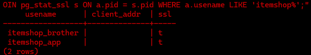

# ItemShopTracker

A command-line tool for tracking Fortnite Item Shop products and how long they have left in the shop. Products are stored in a PostgreSQL database hosted on AWS, so several users can share the same live list from different computers.

## Features

- Add products with a name, price and expiry date
- List all products, color-coded by time remaining:
  - 🔴 Less than 1 day
  - 🟡 Less than 2 days
  - 🟢 More than 2 days
  - ⚪ Expired
- Delete products by id
- Input validation with clear error messages
- Shared database for multiple users

## Tech Stack

- **Python** with [psycopg 3](https://www.psycopg.org/psycopg3/)
- **PostgreSQL 18**
- **AWS EC2** (Ubuntu Server 26.04 LTS)

## Architecture

```
 User A (Windows) ──┐
                    ├── TLS 1.3 ──►  AWS EC2 (Frankfurt)  ──►  PostgreSQL 18
 User B (Windows) ──┘                Security Group:
                                     only the home IP is allowed
```

## Security

The project was built with security in mind at every layer:

**Application**
- Parameterized queries everywhere (no SQL injection)
- Credentials are loaded from a `.env` file that is never committed
- SSL is required for every database connection (`sslmode=require`)
- Dependency versions are pinned in `requirements.txt`

**Database**
- Each user has their own login role; accounts are never shared
- Roles follow the principle of least privilege: only `SELECT`, `INSERT` and `DELETE` on the `products` table. No `UPDATE`, `DROP` or admin rights
- `pg_hba.conf` only accepts remote connections over SSL (`hostssl`) with `scram-sha-256` password authentication, and only for the app roles
- `CHECK` constraints enforce valid data at the database level (defense in depth)

**Server**
- SSH and PostgreSQL ports are open only to a single trusted IP address
- Key-based SSH login only (ED25519), no passwords
- Encrypted EBS volume
- IMDSv2 required
- Termination protection enabled
- AWS root account and IAM user protected with MFA

Verified on the server: both users connected with their own roles, over SSL:



## Setup (Windows)

1. Install [Python](https://www.python.org/) (check **"Add python.exe to PATH"**)
2. Clone the repository:
   ```
   git clone https://github.com/Mental-OsiBK0/ItemShopTracker.git
   cd ItemShopTracker
   ```
3. Run `setup.bat` (installs dependencies and creates `.env` from `.env.example`)
4. Fill in your database credentials in `.env`
5. Start the program:
   ```
   python main.py
   ```

## Usage

```
> Black Knight, 200, 2026-11-10
Product added with id 1
> ListProducts
[1] Black Knight | 200.00 TL | 6d 8h left | 2026-11-10 03:00
> DeleteProduct 1
Product 1 deleted.
```

Type `Help` to see all commands.

## Roadmap

- [ ] Automated daily database backups
- [ ] Notifications before products expire
- [ ] Unit tests